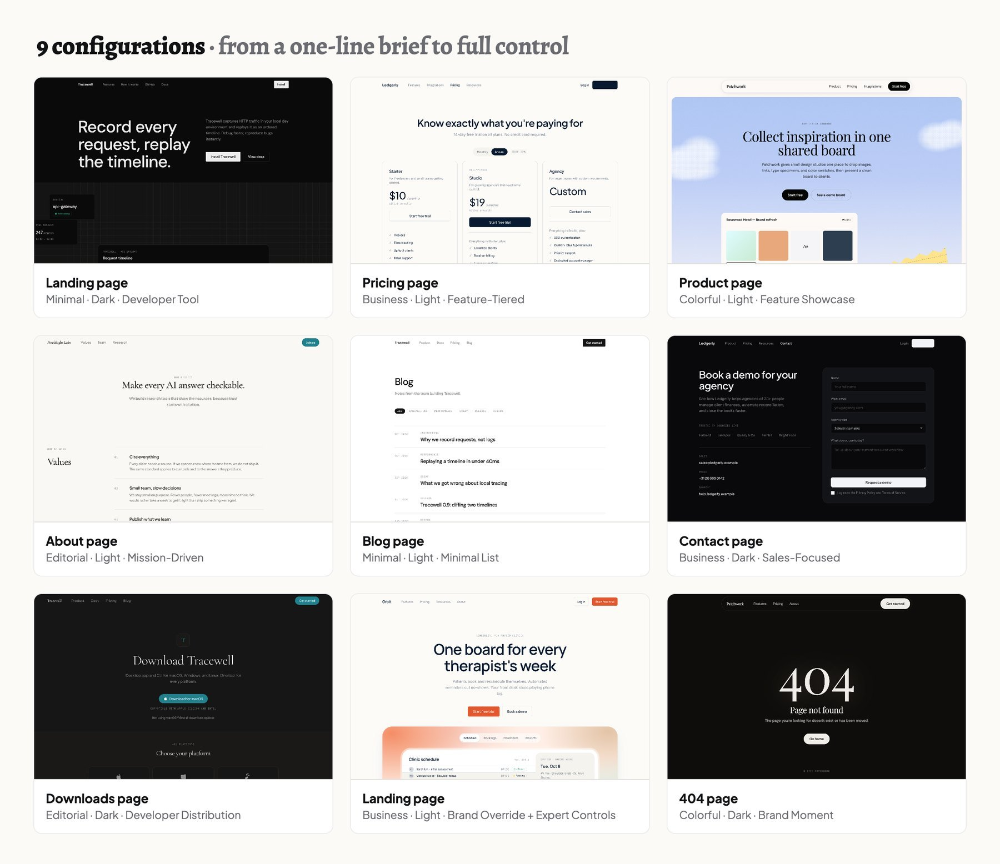
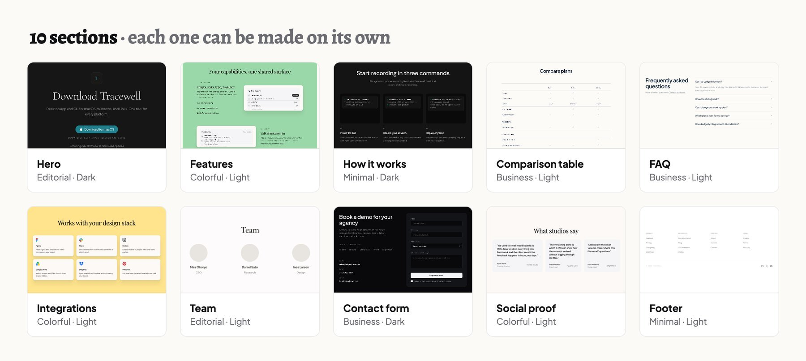

[English](README.md) | [中文](README.zh-CN.md)

# Proof


### A product design skill

[](https://proofdesign.dev)
[](https://docs.anthropic.com/en/docs/claude-code)
[](https://openai.com/index/introducing-codex/)
[](LICENSE)

**Product pages that look shipped, not generated — built from patterns in 400+ real product pages.**

Proof is a product design skill for Claude Code and Codex. Tell it which page you need. It builds a complete, responsive page with a real-looking product showcase, a distinct visual style, and motion that shows your product at work: 8 page types, 10 sections, 4 styles, light and dark.

**See it live → [proofdesign.dev](https://proofdesign.dev)** — every page there was generated by the skill. Open one and scroll, hover, click.

## Start in 30 seconds

```bash
npx skills add senlindesign/proof
```

Then ask your agent for a page:

```text
/proof landing
/proof pricing editorial dark
/proof landing — Patchwork, a shared moodboard for small design studios
```

Other ways to install are [below](#install).

---

## Styles

*The same brief — "Relay, a shared inbox for support teams" — in each style. Click an image to open the live page.*

| Minimal | Business |
| --- | --- |
| [](https://proofdesign.dev/style-minimal-relay) | [](https://proofdesign.dev/style-business-relay) |
| **Colorful** | **Editorial** |
| [](https://proofdesign.dev/style-colorful-relay) | [](https://proofdesign.dev/style-editorial-relay) |

| Style | Character | Signature hero |
| --- | --- | --- |
| **Minimal** (default) | Black, white, and gray; no shadows; sharp edges | A hairline-grid "specimen field" with a focal product view |
| **Business** | Warm and trustworthy; soft shadows; rounded corners | A product stage in a mesh gradient, with feature tabs |
| **Colorful** | Playful and crafted; serif headlines; paper-like cards | A sky with halftone clouds and a paper product sheet |
| **Editorial** | Authored and calm; large serif; one teal accent | A dark "front page" with a paper product window |

Each style was extracted from a real product site with [Taste Lab](https://github.com/senlindesign/taste-skill) and works in light and dark with every page type.

---

## Why it is different

1. **Learned from real products, not the model's taste.** 400+ shipped pages studied through the [Mobbin](https://mobbin.com) MCP; every pattern says why it works and when to skip it.
2. **Four styles with real character.** Each has its own hero, textures, and motion. Two styles are two designs, not a recolor.
3. **A hero full of real-looking product.** Names, statuses, numbers — never grey placeholder boxes.
4. **The whole site, or one section.** A full landing page, or only a pricing table, an FAQ, or a footer.
5. **Your brand, your content.** Give as much as you have. Gaps are filled with finished sample content, and the QA report lists each one to replace.
6. **Checked before you see it.** It checks layout rhythm, style fidelity, real logos, and invented facts, then tells you what passed.

**What it avoids** — the usual signs of an AI-made page: the same centered template repeated down the page · three identical feature cards · grey boxes and drawn logos · a blue-to-purple gradient · invented facts presented as real · everything fading up on scroll.

### Five layers of product design

Most design skills decide only how a page looks. Proof also decides what goes on the page and in what order, because it learned them from 400+ shipped pages — patterns the market has already tested. Layers from Jesse James Garrett's *The Elements of User Experience*.

| Layer | What the skill decides |
| --- | --- |
| **Strategy** *(inferred)* | Who the page is for and what it must get them to do — read from your brief and matched to pages that already work. Proof does not do your strategy for you. |
| **Scope** | Which sections to include, and which to omit |
| **Structure** | The order of the sections, and how their layouts alternate |
| **Skeleton** | The layout in each section |
| **Surface** | The style, textures, and motion |

So one product can get two different pages: for developers who want to try it now, a short page (hero, features, sign-up); for IT directors new to the category, an explanation, how it works, and a security section.

---

## What you can build

[](https://proofdesign.dev/#pages)

| Page type | Use it for | Archetypes |
| --- | --- | --- |
| **Landing** | Your product, for new visitors | SaaS Tool · SaaS Platform · Developer Tool · Creative Tool |
| **Pricing** | Plans and billing | Feature-Tiered · Usage-Based · Simple Binary · Enterprise-First |
| **Product** | Features in depth, for people who evaluate | Feature Showcase · Platform Overview · Product Deep-Dive |
| **About** | The story of your company and team | Company Story · Team-First · Mission-Driven |
| **Contact** | Questions, support, and demo requests | Simple Contact · Department Routing · Sales-Focused · Support Hub |
| **Blog** | Articles and changelogs | Grid Index · Editorial · Minimal List |
| **Downloads** | Desktop apps, CLIs, and SDKs | Platform Selector · Multi-Product · Developer Distribution |
| **404** | A way back for lost visitors | Minimal Redirect · Navigational Recovery · Brand Moment |

[](https://proofdesign.dev/#sections)

Every page also gets real product showcases (8 recipes), 17 signature layouts seen on real sites, atmosphere from the style's palette, motion that shows the product working (respecting "reduce motion"), real logos from icon libraries, and headlines written to patterns measured on 72 real ones.

---

## Install

| Where | How |
| --- | --- |
| **Any agent, one command** | `npx skills add senlindesign/proof` ([skills.sh](https://skills.sh) asks which agent to install to) |
| **Claude Code plugin** | `/plugin marketplace add senlindesign/proof`, then `/plugin install proof@proof`. Use it as `/proof:proof`; update with `/plugin update`. |
| **Claude Code, by hand** | `git clone https://github.com/senlindesign/proof.git` then `cp -R proof/skills/proof ~/.claude/skills/` |
| **Codex, by hand** | `git clone https://github.com/senlindesign/proof.git` then `cp -R proof/skills/proof ~/.codex/skills/` |
| **Cursor, Windsurf, others** | Tell the agent to read `skills/proof/SKILL.md` |

Or paste this to an agent that can run shell commands:

```text
Install the Proof skill: clone https://github.com/senlindesign/proof and copy its skills/proof folder into my skills folder (~/.claude/skills/ for Claude Code, ~/.codex/skills/ for Codex). Then check that SKILL.md is there.
```

No build step, no dependencies. With Python 3 installed, the skill also checks each page before it hands it over.

## Usage

| You want | Type |
| --- | --- |
| A landing page now | `/proof landing` |
| A page in a style and theme | `/proof pricing editorial dark` |
| One section only | `/proof hero colorful` |
| A page for your audience | Add who visits, what they must do, what worries them, and what real material you have — or paste a PRD or brand guide. |
| Your brand | `/proof landing business — accent #E4572E, display font Manrope` |
| Full control | `/proof blog editorial dark — archetype B, no newsletter, as a Next.js page in this project` |
| Help to decide | Type only `/proof`. It asks one round of questions, then builds. |

The default output is one HTML file. Ask, and it writes code for your project's stack instead.

---

## Good for / not for

**Good for:** product and marketing website pages; a first draft close enough to ship; trying one product in several styles.
**Not for:** app screens and dashboards, online stores, real forms, payments, or other business logic.

## FAQ

**Do I need Mobbin?** No. Mobbin was the research source; everything is already inside the skill and works offline.

**What do I get?** One self-contained HTML file by default, or code for your stack if you ask.

**Why is there sample content in my page?** So the first draft is complete. Facts are never invented as real; the QA report lists every sample item to replace.

**Can I use my own colors and fonts?** Yes — give an accent color and a display font, or paste a brand guide.

**How do I update?** Run the install command again, use `/plugin update`, or `git pull` and copy the folder again.

---

## How it was built

410 research records of real product pages, 55 product showcases, 32 signature moves, and 72 headlines, studied through the [Mobbin](https://mobbin.com) MCP. A second agent checked every knowledge file against the research. A golden test set of 19 requests covers all page types, styles, and themes; scripts, a claims audit, and a screenshot judge check every result. See [`evals/`](evals/). Working rules for contributors are in [`AGENTS.md`](AGENTS.md).

## License

[MIT](LICENSE)

## Support

Proof is free and open source. If it helps you, you can [buy me a coffee](https://buymeacoffee.com/senlin), or use Alipay or WeChat:

<table>
  <tr>
    <td align="center"><br>Alipay</td>
    <td align="center"><br>WeChat</td>
  </tr>
</table>

Starring the repo and sharing [proofdesign.dev](https://proofdesign.dev) help too. Thank you!
